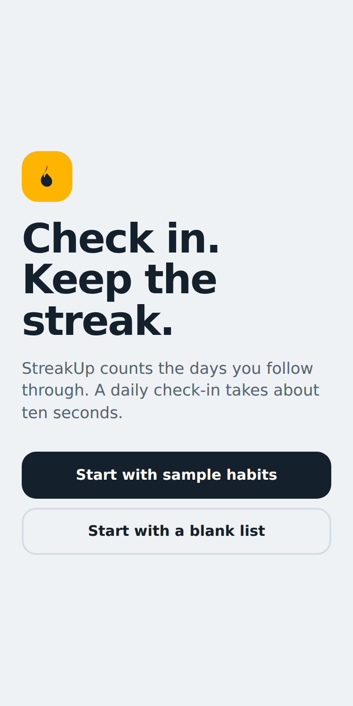
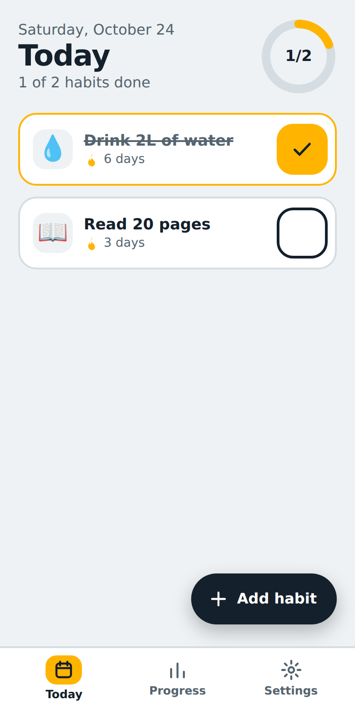
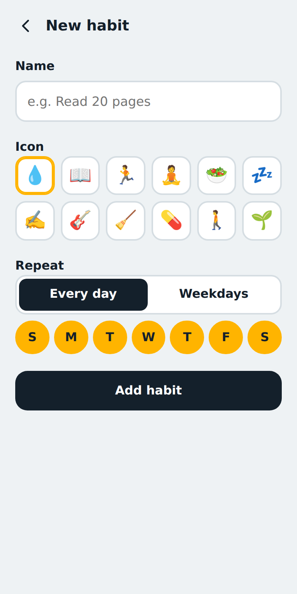
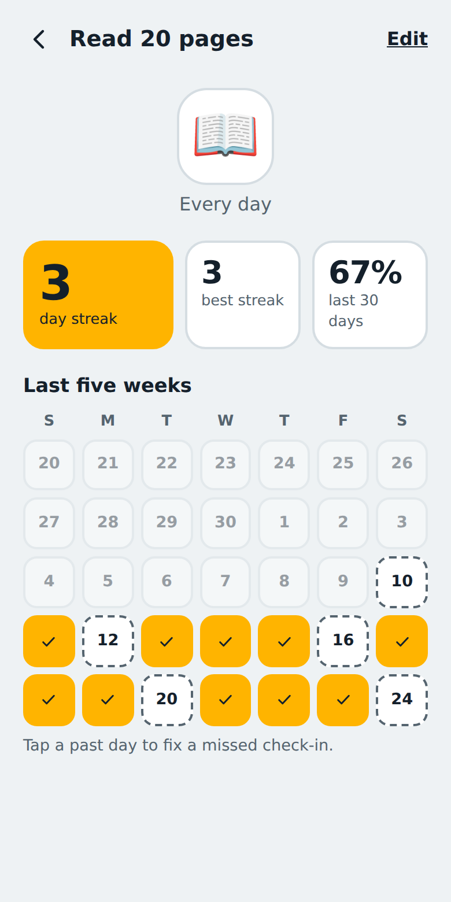
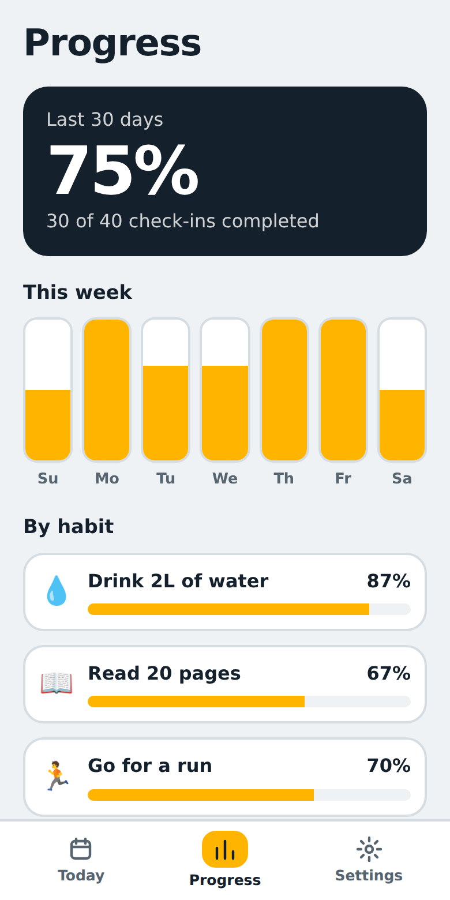
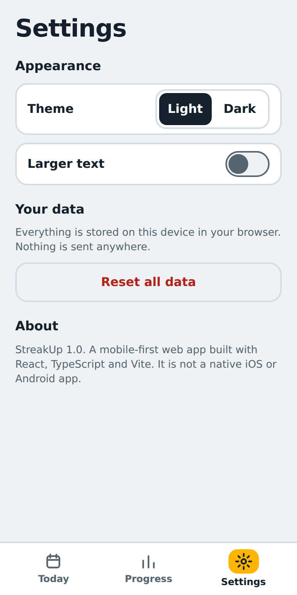

# StreakUp

A mobile-first habit tracker. Check habits off in about ten seconds a day and watch your streaks grow.

## Tech stack (what this project actually uses)

- **React 18** + **TypeScript** for the UI
- **Vite 5** for the dev server and build
- Plain **CSS** (no UI framework)
- Data saved in the browser's **localStorage** (no backend, no account)

This is a **mobile-responsive web app**. It is **not** React Native, Flutter, or a native iOS/Android app. It runs in any browser and is laid out for phone screens; on a desktop it appears as a phone-sized column.

## Screens implemented

| # | Screen | What it does |
|---|--------|--------------|
| 1 | Welcome | First-run intro. Start with sample habits or a blank list. |
| 2 | Today | Habits scheduled for today, a progress ring, large check buttons, current streak per habit. |
| 3 | Add / Edit Habit | Name, icon, and repeat days, with validation. Edit mode also lets you delete a habit. |
| 4 | Habit Detail | Current streak, best streak, 30-day rate, and a five-week calendar where past days can be corrected. |
| 5 | Progress | 30-day completion, a 7-day bar chart, and a per-habit breakdown. |
| 6 | Settings | Light/dark theme, larger text, reset all data. |

Navigation uses a bottom tab bar (Today, Progress, Settings) so everything is reachable with one thumb.

## Screenshots

| Welcome | Today | Add habit |
|---|---|---|
|  |  |  |

| Habit detail | Progress | Settings |
|---|---|---|
|  |  |  |

## Run locally

Requires [Node.js](https://nodejs.org) 18 or newer.

```bash
npm install
npm run dev
```

Open the address Vite prints (usually http://localhost:5173). To see the phone layout on a computer, open your browser's developer tools and switch on device mode. Because the dev server uses `--host`, you can also open the "Network" address on a phone connected to the same Wi-Fi.

Other commands:

```bash
npm run build     # type-check and create a production build in dist/
npm run preview   # serve the production build locally
```

## Project structure

```
src/
  App.tsx            app state and simple screen routing
  types.ts           shared types
  dates.ts           date helpers, streak and rate calculations
  storage.ts         localStorage hook and sample data
  styles.css         all styling (light/dark themes via CSS variables)
  components/        TabBar, Ring, Icons
  screens/           Welcome, Today, HabitForm, HabitDetail, Progress, SettingsScreen
```

## Notes

- Streaks count consecutive *scheduled* days. A habit that is not scheduled on a given weekday does not break the streak, and today stays "open" until you check in.
- Reminders and notifications are not implemented; this version covers the main screens only.
